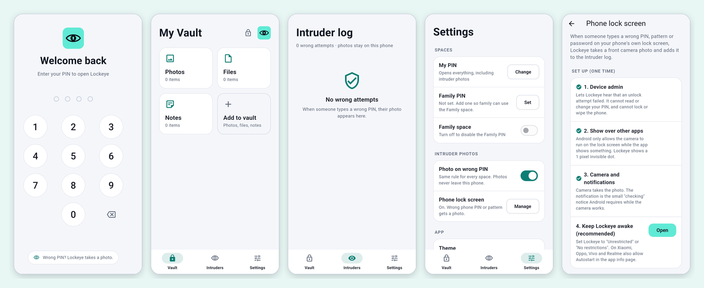
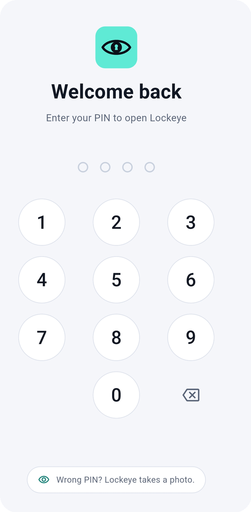
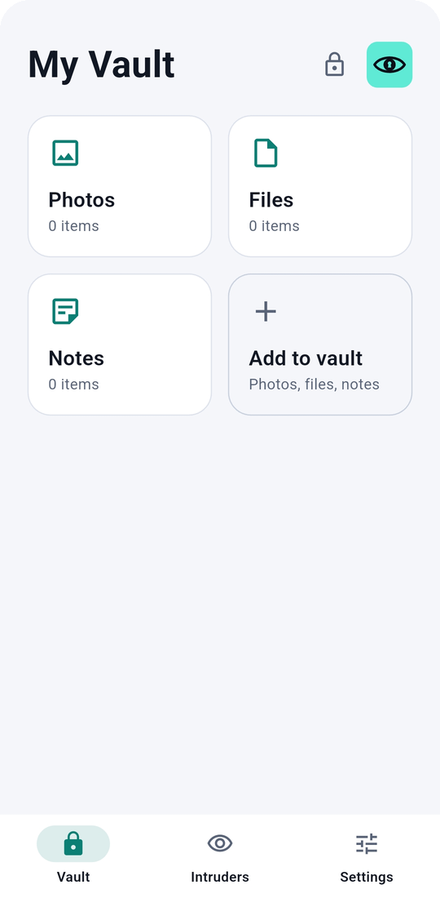
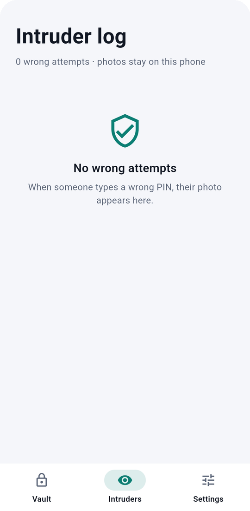
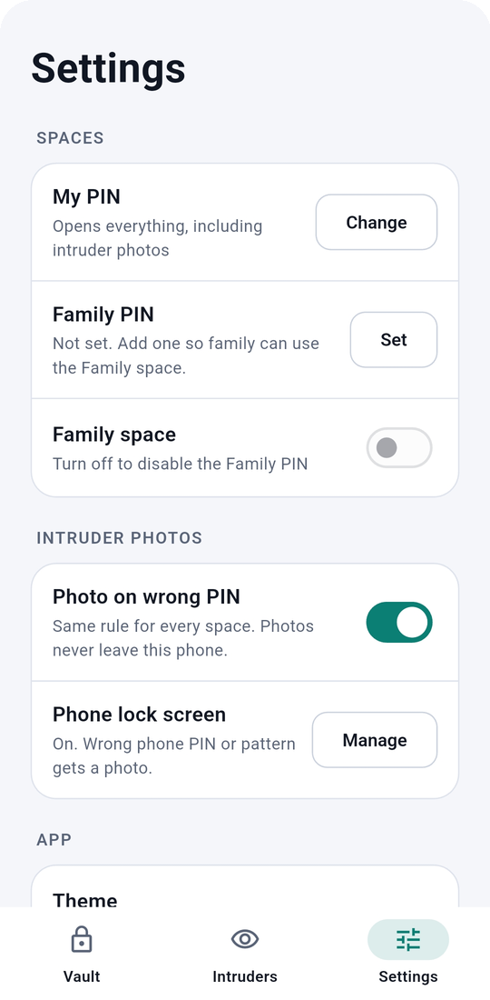
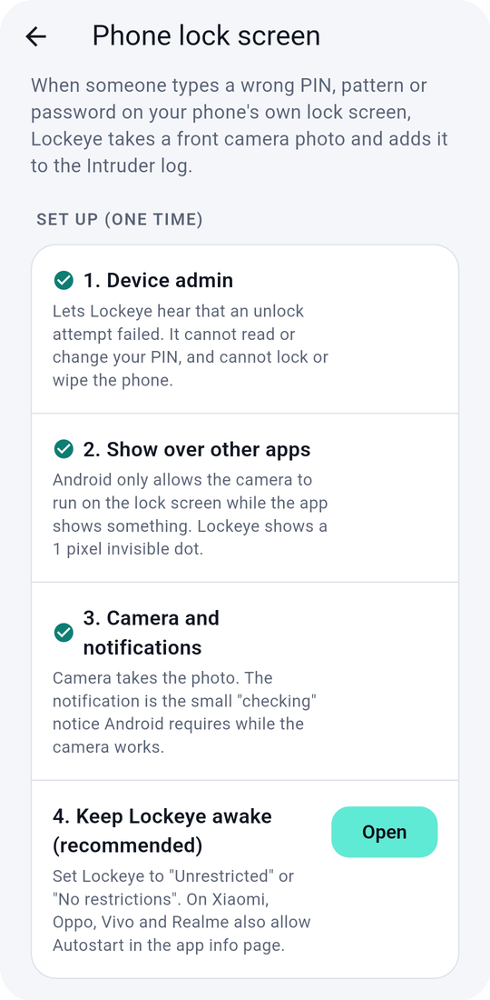
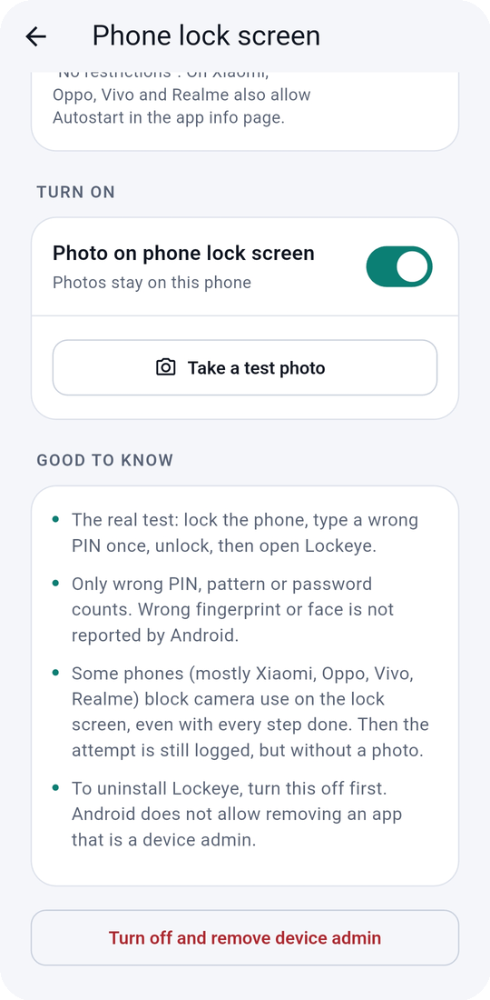

<div align="center">

# Lockeye

**A private vault for Android that catches whoever guesses wrong.**

Type a wrong PIN and the front camera quietly takes a photo.
Offline. Open source. No accounts, no ads, no tracking.

[](../../releases/latest)
[](LICENSE)


<br>



</div>

---

## What it does

Lockeye is a small vault for your photos, files and notes. It has two PINs, and anyone who types a wrong one is photographed. It can also watch your phone's own lock screen, so a wrong phone PIN or pattern gets a photo too.

Everything stays on your phone. There is no server, no sign-in and no network use, apart from the optional update check.

## Features

### Two PINs, two spaces

| PIN | Opens |
| --- | --- |
| **Your PIN** | Everything: your vault, the Family space, the intruder log and Settings |
| **Family PIN** | Only the Family space. Never your vault, the intruder photos or Settings |

The Family PIN is optional. You can switch it off at any time.

### Photo on every wrong PIN

- A wrong PIN in Lockeye takes a front camera photo, whoever typed it. Family included.
- The camera opens only for the photo and closes right after, so Android's green camera dot is not sitting on the lock screen.
- After 5 wrong tries in a row the keypad waits 30 seconds, then longer (up to 5 minutes).
- You can turn the photo off in **Settings → Photo on wrong PIN**.

### Phone lock screen (optional)

Lockeye can also photograph wrong attempts on your **phone's own** lock screen (the PIN, pattern or password you use to unlock the phone).

Set it up in **Settings → Phone lock screen**. It walks you through four steps:

1. **Device admin.** Lets Lockeye hear that an unlock attempt failed. Lockeye asks for one policy only, "watch login attempts". It cannot read or change your PIN, and cannot lock or wipe the phone.
2. **Show over other apps.** Android only lets an app use the camera from the background while it shows something. Lockeye shows a 1 pixel invisible dot for a few seconds.
3. **Camera and notifications.** The camera takes the photo. The notification is the small "checking" notice Android requires while the camera runs.
4. **Keep Lockeye awake (recommended).** Set battery to "Unrestricted". On Xiaomi, Oppo, Vivo and Realme also allow Autostart.

Then switch it on and press **Take a test photo**.

**Good to know**

- Only a wrong **PIN, pattern or password** counts. Android does not report wrong fingerprints or faces.
- Some phones (mostly Xiaomi, Oppo, Vivo, Realme) block camera use on the lock screen even with every step done. Then the attempt is still logged, but without a photo.
- To uninstall Lockeye, first open **Settings → Phone lock screen → Turn off and remove device admin**. Android does not allow removing an app that is a device admin.

### Intruder log

Every wrong attempt is listed newest first, with the time, the attempt number, the source (Lockeye or phone lock screen) and the photo. New attempts are marked, and the Intruders tab shows a badge. Tap a photo to view it, or delete one or all.

### Vault

- **Photos** from your gallery
- **Files** of any type
- **Notes** with a title and text

Everything is kept in the app's private folder. Other apps and the gallery cannot see it. Your originals stay where they were, so delete them from the gallery yourself if you want them gone.

### Auto lock

Lockeye locks the moment you leave the app, and closes any open photo, note or dialog so nothing stays visible behind the lock.

### Light and dark theme

Follows your phone, or choose Light or Dark in Settings.

### In-app updates

**Settings → Updates → Check** looks for a newer version on GitHub. If there is one, Lockeye downloads the APK and hands it to Android to install. Your PINs, vault and settings stay as they are.

## Screenshots

<table>
  <tr>
    <td align="center" width="33%"><br><sub><b>Lock</b><br>Wrong PIN? A photo is taken</sub></td>
    <td align="center" width="33%"><br><sub><b>Vault</b><br>Photos, files and notes</sub></td>
    <td align="center" width="33%"><br><sub><b>Intruder log</b><br>Every wrong attempt, newest first</sub></td>
  </tr>
  <tr>
    <td align="center"><br><sub><b>Settings</b><br>PINs, family space, theme, updates</sub></td>
    <td align="center"><br><sub><b>Phone lock screen</b><br>Four guided setup steps</sub></td>
    <td align="center"><br><sub><b>Turn on</b><br>Switch it on and take a test photo</sub></td>
  </tr>
</table>

## Install

1. Open the [latest release](../../releases/latest).
2. Download `Lockeye-vX.Y.Z.apk`.
3. Open it on your phone and allow "install from this source" if Android asks.

Later versions install from inside the app.

## Permissions

| Permission | Why | Needed for |
| --- | --- | --- |
| Camera | Take the photo after a wrong PIN | Always |
| Internet | Check for updates when you tap the button | Updates only |
| Install packages | Install a downloaded update after you confirm | Updates only |
| Device admin | Learn that a phone lock screen attempt failed | Phone lock screen only |
| Display over other apps | Let the camera run on the lock screen | Phone lock screen only |
| Foreground service (camera) | Run the camera for a few seconds after a failed attempt | Phone lock screen only |
| Notifications | Show the notice Android requires while the camera runs | Phone lock screen only |

The phone lock screen permissions are only requested if you set that feature up.

## Privacy

Lockeye collects nothing. No analytics, no ads, no crash reports, no third-party services. PINs are stored only as salted hashes, and photos never leave the phone. See [PRIVACY.md](PRIVACY.md) for the full policy.

## How it is built

- **Flutter** (Material 3), Android only
- PINs: salted HMAC-SHA256, 5000 rounds, stored as `salt$hash`
- Camera: the `camera` plugin for the in-app keypad; native **Camera2** in Kotlin for the phone lock screen
- Phone lock screen: a `DeviceAdminReceiver` (watch-login policy) starts a short camera foreground service. The photo and a log line are written to app storage, and Lockeye imports them the next time it opens

```
docs/screenshots/   images used in this README
lib/
  core/       app state, PIN hashing, models, theme
  screens/    lock, setup, vault, photos, files, notes, intruders, settings, phone lock
  services/   intruder camera, vault storage, phone lock bridge, updater
  widgets/    logo, PIN pad, shared cards
android/app/src/main/kotlin/com/lumioapps/lockeye/
              admin receiver, camera foreground service, Camera2 capture, method channel
```

## Build from source

You need the [Flutter SDK](https://docs.flutter.dev/get-started/install).

```
flutter create --org com.lumioapps --project-name lockeye --platforms android .
flutter pub get
dart run flutter_launcher_icons
flutter analyze
flutter test
flutter build apk --release
```

`flutter create` is only needed once, to generate the Android project. Run it before copying this repository's files over it, so the custom manifest and Kotlin files are kept.

## Releases

Pushing a tag like `v1.1.1` starts the GitHub Actions release workflow. It analyzes the code, builds the APK, signs it with the release key kept in repository secrets, and publishes `Lockeye-vX.Y.Z.apk` as a GitHub Release. That release is what the in-app updater looks for, so the repository and its releases must be public.

## Limits

Lockeye is a deterrent and a witness, not a safe.

- The vault is **not encrypted** yet. It is protected by the PIN and by Android's private app storage.
- Someone with full access to an unlocked or rooted phone can reach app storage.
- Phone lock screen photos depend on how your phone's maker handles background camera use.

## License

[MIT](LICENSE) © Lumio Apps
